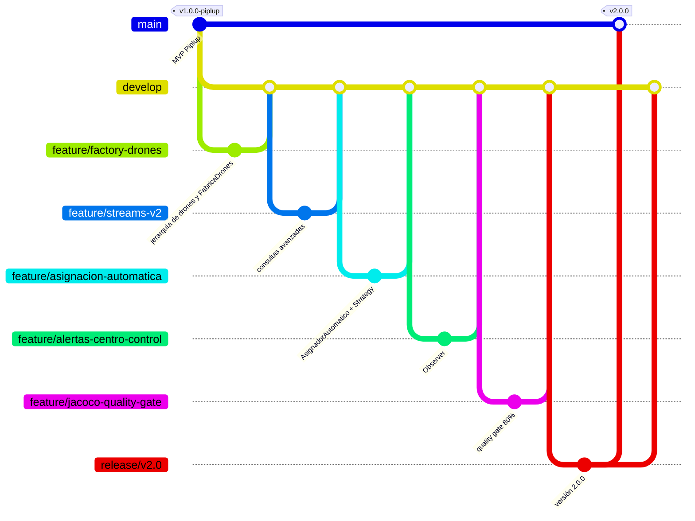

# AquaPort 🌊

Sistema de gestión de drones acuáticos de la Escuela Colombiana de Ingeniería.
Curso DOSW · 2026-2

| Versión | Nivel | Alcance |
|---|---|---|
| v1.0.0 | Piplup (MVP) | 4 drones del mismo modelo, asignación manual por el operador |
| v2.0.0 | Prinplup | 15 drones de 3 tipos, asignación automática con Strategy y alertas con Observer |

## Descripción de la v2

AquaPort v2 asigna automáticamente el drone más adecuado para cada solicitud de transporte. La flota tiene 3 tipos:

| Tipo | Clase | Capacidad de carga |
|---|---|---|
| Superficial | `DroneSuperficial` | 500 g |
| Semisumergido | `DroneSemisumergido` | 1500 g |
| Buceador | `DroneBuceador` | 300 g |

Flujo: `SolicitudMision` → filtrar drones aptos (operativos y con capacidad para el peso) → la estrategia activa elige el drone → se valida que esté operativo → se crea la `Mision` y el drone pasa a `EN_MISION`. Si la misión es CRÍTICA y no hay drone, o si el drone elegido no está operativo, se notifica a los observadores (centro de control y técnico de mantenimiento).

## Requisitos

- Java 17 o superior
- Maven 3.8 o superior

## Cómo compilar, probar y medir cobertura

```bash
mvn clean verify
```

- Ejecuta las pruebas (JUnit 5 + Mockito).
- Genera el reporte de JaCoCo en `target/site/jacoco/index.html`.
- Aplica el quality gate: el build falla si alguna clase tiene menos del 80% de líneas cubiertas.

Demostraciones por consola: `AquaPortApp` (MVP) y `AquaPortV2App` (flota de 15 drones).

## Estructura

```
src/main/java/edu/eci/dosw/aquaport/
├── domain/           modelo e interfaces (DroneAcuatico, Mision, SolicitudMision,
│                     EstrategiaSeleccion, ObservadorMision, RepositorioDrones, FabricaDrones…)
├── service/          lógica de negocio (AsignadorAutomatico, AnalizadorFlota, ValidadorMision…)
│   ├── estrategia/   implementaciones de Strategy
│   └── observador/   implementaciones de Observer
├── repository/       implementaciones de repositorios
└── config/           configuración de la fábrica de drones
docs/                 diagramas, requisitos, plantillas, mocks y evidencias
```

## Flujo de trabajo con GitFlow

| Rama | Propósito |
|---|---|
| `main` | Solo versiones entregadas, cada una con su tag (`v1.0.0-piplup`, `v2.0.0`) |
| `develop` | Integración del trabajo en curso |
| `feature/*` | Una rama por funcionalidad, integrada a `develop` por Pull Request |
| `release/v2.0` | Preparación de la versión 2.0: solo ajustes, sin funcionalidades nuevas |
| `hotfix/*` | Corrección urgente sobre `main`, que también se integra a `develop` |

### Diagrama de ramas de la v2



Commits con el formato `tipo: descripción`: `feat`, `test`, `refactor`, `fix`, `docs`, `build` y `chore`. En las clases desarrolladas con TDD, el commit `test:` (fase RED) siempre va antes del `feat:` (fase GREEN).

## Auditoría SOLID de la v2

### Qué principio aplica cada clase o interfaz

| Clase / interfaz | Principio | Cómo |
|---|---|---|
| `DroneAcuatico` y subclases | LSP, OCP | Cada subclase solo define su tipo y capacidad; cualquiera reemplaza al padre |
| `FabricaDrones` + `CreadorDrone` | OCP | Registro de tipos sin `switch`; un tipo nuevo no modifica la fábrica |
| `ConfiguracionFabricaDrones` | SRP | Único lugar que conoce las subclases concretas |
| `EstrategiaSeleccion` | ISP, OCP | Un solo método; nuevas estrategias sin tocar el asignador |
| `MayorBateriaStrategy`, `ZonaCercanaStrategy` | SRP, LSP | Cada una tiene un único criterio; son intercambiables |
| `ObservadorMision` | ISP | Un solo método; ningún observador queda con métodos vacíos |
| `CentroControlObserver`, `TecnicoMantenimientoObserver` | SRP, DIP | Solo comunican la alerta; reciben su `PrintStream` por constructor |
| `RepositorioDrones`, `RepositorioMisiones` | DIP, ISP | Abstracciones en `domain` con solo los métodos que se usan |
| `AsignadorAutomatico` | SRP, OCP, DIP | Solo coordina la asignación; depende de interfaces inyectadas |
| `AnalizadorFlota`, `ClasificadorMisiones` | SRP | Consultas sobre drones y sobre misiones, separadas |
| `SolicitudMision`, `Mision` | SRP | Lo pedido y lo asignado son objetos distintos |

### Dónde se respeta cada principio y por qué importa en AquaPort

**S — Responsabilidad única.** `AsignadorAutomatico` solo coordina: no elige el drone (lo hace la estrategia), no imprime alertas (lo hacen los observadores) y no sabe de dónde salen los drones (lo hace el repositorio). `AnalizadorFlota` consulta drones y `ClasificadorMisiones` consulta misiones. *Importa porque* en AquaPort cambian por separado las reglas de selección, los canales de alerta y el origen de los datos de la flota; si todo estuviera en una clase, cada cambio arriesgaría las demás funciones.

**O — Abierto/cerrado.** Para agregar el cuarto tipo de drone (Sumergible Profundo) basta con crear la clase `DroneSumergibleProfundo` y agregar una línea en `ConfiguracionFabricaDrones`. No se modifican `AsignadorAutomatico`, `ValidadorMision` ni `FabricaDrones`. Lo mismo pasa con una estrategia nueva (otra clase que implemente `EstrategiaSeleccion`) o con un observador nuevo. *Importa porque* la flota de la ECI va a seguir creciendo (Empoleon tendrá 60 drones) y el núcleo de asignación no debe romperse cada vez.

**L — Sustitución de Liskov.** Donde se espera un `DroneAcuatico` funciona cualquiera de los 3 tipos: ninguna subclase lanza excepciones ni retorna `null` donde el padre no lo hace, y todas heredan la misma validación. Las pruebas usan variables de tipo `DroneAcuatico` con objetos de cualquier subclase. *Importa porque* el asignador y las estrategias trabajan con la flota mezclada y no pueden tener casos especiales por tipo.

**I — Segregación de interfaces.** `EstrategiaSeleccion`, `ObservadorMision` y `CreadorDrone` tienen un solo método cada una; `RepositorioDrones` solo expone `listarTodos()`. Ninguna implementación tiene métodos vacíos ni `UnsupportedOperationException`. *Importa porque* el técnico de mantenimiento y el centro de control reciben la misma alerta, y ninguno está obligado a implementar operaciones que no usa.

**D — Inversión de dependencias.** `AsignadorAutomatico` recibe `EstrategiaSeleccion` y `RepositorioDrones` por constructor y nunca hace `new` de una clase concreta. Las interfaces viven en `domain` y las implementaciones en `service.estrategia`, `service.observador` y `repository`. *Importa porque* permite probar el asignador con Mockito sin drones reales, y porque en el futuro la flota podrá venir de una base de datos o de la API de condiciones hídricas sin cambiar la lógica de asignación.
